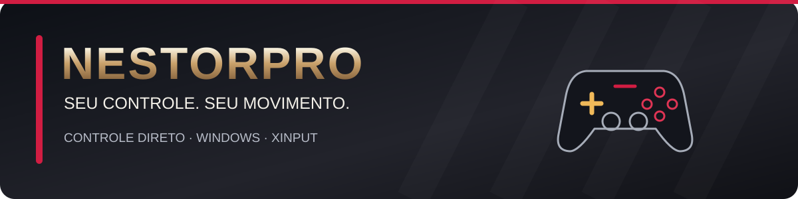
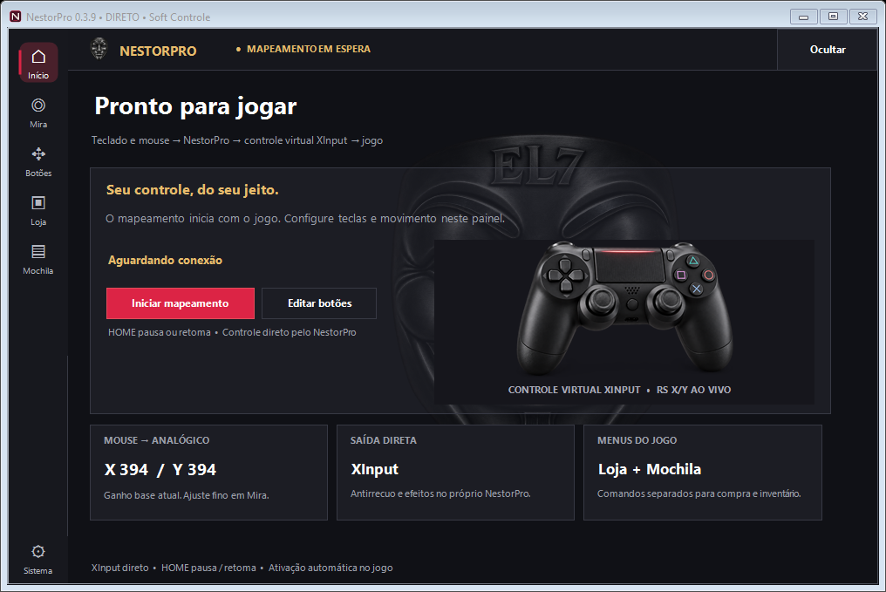

# NestorPro · Controle direto

**Teclado e mouse → controle virtual XInput. Ajustes no seu painel.**

[Conheça o painel](#o-painel) · [Loja e inventário](#pensado-também-para-os-menus-do-warzone) · [Manual](docs/MANUAL.md) · [Relatar problema](../../issues/new/choose)

## Seu controle, do seu jeito

O **NestorPro DIRETO** converte teclado e mouse em um controle virtual Xbox 360 no Windows. A edição atual reúne mapeamento, sensibilidade e ajustes experimentais no próprio aplicativo, sem depender do DS4Windows.

O desenvolvimento inclui fluxos específicos para o **Warzone**, com atenção à navegação da loja, confirmação de compras e inventário.

## O painel

*Captura real da interface em ambiente de validação. A imagem mostra o painel em espera; os valores são exemplos e podem variar conforme o perfil.*

| Recurso | O que você ajusta |
|---|---|
| Sensibilidade por eixo | X e Y independentes, com e sem mirar |
| Botões personalizáveis | Teclas e botões do mouse pelo editor |
| Loja | Navegação e confirmação dedicadas ao menu |
| Inventário | Navegação pelos itens e comando de descarte conforme o perfil |
| Ajustes experimentais | Compensação vertical e pequenos movimentos opcionais dos analógicos |
| Diagnóstico | Contadores de entrada, relatórios virtuais e indicação de falha |
| Controle do mapeamento | HOME pausa e retoma; painel pode ser recolhido para a bandeja |

## Pensado também para os menus do Warzone

A loja e o inventário têm caminhos próprios de comandos. Na loja, o roteamento utiliza pulsos de navegação e confirmação, bloqueia o movimento nativo do mouse nessa camada e evita enviar o direcional de troca do modo de disparo ao navegar entre colunas.

**O objetivo é comprar e navegar sem interferências nos comandos da partida.** Há testes automatizados de roteamento e relatos de uso no ambiente de desenvolvimento. Isso não significa ausência de bugs em toda versão do jogo, configuração ou hardware: veja [o que foi validado e o que falta](docs/VALIDACAO.md).

## Situação do download

**Código-fonte gratuito disponível. Pacote executável pronto para instalar ainda em preparação.**

O executável ainda não está disponibilizado neste repositório. Estamos concluindo a preparação de instalação, a revisão de licenças dos componentes e a validação em outros computadores. Quando houver uma distribuição aprovada, o link oficial será publicado nesta página.

O código está em [src/NestorPro](src/NestorPro), sob a [licença MIT](LICENSE), com os créditos da base original preservados. Você pode estudar, compilar e modificar o projeto, respeitando os termos das dependências.

**[Baixar código-fonte em ZIP](https://github.com/CharlesNestor88/NestorPro/archive/refs/heads/main.zip)** · **[Como compilar](docs/COMPILAR.md)** · **[Créditos e dependências](THIRD-PARTY-NOTICES.md)**

## Antes de usar

- Para compilar, siga [as instruções do código-fonte](docs/COMPILAR.md).
- Consulte os [requisitos e dependências](docs/REQUISITOS.md).
- Comece pela [configuração básica e pelo manual](docs/MANUAL.md).
- Use o [roteiro de teste](docs/VALIDACAO.md) para verificar mouse, botões, loja e inventário.
- Confira as [limitações e os componentes de terceiros](docs/COMPONENTES.md).

O modo direto utiliza **Interception** para captura e **ViGEmBus** para saída virtual. Não promete latência zero, um número fixo de milissegundos ou aumento da assistência de mira do jogo. A compatibilidade com jogos, atualizações e regras de uso precisa ser verificada no ambiente de destino.

## Ajude o projeto a melhorar

Se a proposta foi útil para você, considere deixar uma **⭐** e acompanhar as atualizações.

Encontrou um problema? Abra um [relato](../../issues/new/choose) com versão do Windows, versão do aplicativo, modelo do mouse, passos e resultado esperado. Remova informações pessoais de imagens e logs.

Ideias de interface, acessibilidade e instalação também são bem-vindas.

---

**NestorPro — Seu controle. Seu movimento.**

Projeto independente, sem vínculo oficial com Activision, Call of Duty, Warzone, Microsoft, Sony ou DS4Windows. Marcas citadas pertencem aos respectivos titulares.
